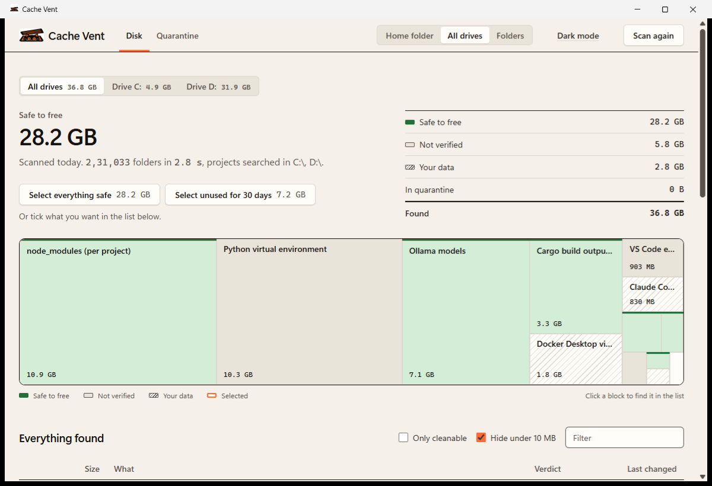

<p align="center">
  
</p>

<p align="center">
  <strong>See what every AI and developer tool keeps on your disk, what it is, and whether it's safe to remove.</strong>
</p>

<p align="center">
  
  
  
  
</p>

---

Model weights, `node_modules`, virtual environments, build output, package caches and chat histories pile up across your drives. Each tool keeps its own, and none of them tell you which parts matter. Cache Vent finds them, explains each one in plain language, and marks it as **safe to free**, **not verified** or **your data**. It only offers to remove what is backed by a documented source, and even then it moves items to a quarantine you can restore from instead of deleting them.

<p align="center">
  
</p>

## Highlights

- **Fast.** Scans every fixed drive on a laptop (231,000 folders) in under 3 seconds, using about 40 MB of memory. That's 3.4× faster than a plain `filepath.WalkDir` over the same drive. See [BENCHMARKS.md](BENCHMARKS.md).
- **Explains, doesn't guess.** Every verdict comes from a definition that cites its source. Anything without one is shown as *not verified* and is never offered for cleaning.
- **Reversible by design.** Cleaning is a rename into a quarantine on the same drive. It's instant, takes no extra space, and is restored with one click for 14 days.
- **Knows your projects.** It ties `node_modules`, `.venv`, Poetry and pipenv environments to the project that owns them, and flags orphaned environments whose project is gone.
- **Private.** A single local executable with no account, network calls or telemetry. The desktop UI is served only to its own window on `127.0.0.1`, behind a per-session token.
- **Small.** One 8 MB binary is both the desktop app and the CLI, with no installer or runtime.

## What it finds

| Tool | What | Verdict |
|---|---|---|
| Node.js | `node_modules` per project, npm cache, Yarn cache | Safe to free |
| | pnpm content store | Not verified |
| Python | virtual environments (venv, Poetry, pipenv), with package sizes | Per environment |
| | pip cache, uv cache, `__pycache__` | Safe to free |
| | conda environments | Not verified |
| Rust | Cargo `target/` build output | Safe to free |
| Gradle | project `.gradle` cache | Safe to free |
| Ollama, Hugging Face | downloaded models | Safe to free (downloads again) |
| LM Studio, ComfyUI, Stable Diffusion WebUI | models | Not verified |
| ComfyUI | generated outputs | Your data |
| Claude Code, Codex CLI, Cursor | session history, workspace storage | Your data |
| Claude Code, Claude Desktop, Cursor, VS Code | app caches, snapshots, extensions | Not verified |
| Docker Desktop | virtual disk | Your data |
| Windows | your temp folder (items older than the cutoff only) | Safe to free |

Definitions are plain YAML files in [`definitions/`](definitions). Adding a tool takes no Go code. See [DEFINITIONS.md](DEFINITIONS.md).

> **Status:** early. The verdicts are drafted from each tool's documentation and haven't yet been confirmed against fresh installs of every tool. If something looks wrong, open an issue with the path and the tool version.

## Install

**macOS and Linux:** paste into Terminal.

```sh
curl -fsSL https://cachevent.kelados.in/install.sh | sh
```

On macOS this builds `Cache Vent.app` in Applications, signs it ad hoc on your Mac and clears the download flag, so it opens from Launchpad without an Apple Developer ID, admin password or System Settings changes. On Linux it installs `~/.local/bin/cachevent` and a launcher in your applications menu. Both verify the SHA256 checksum first, need no `sudo`, and uninstall with `sh -s -- --uninstall`.

**Windows:** paste into PowerShell, or download `CacheVent-windows-x64.exe` from the site.

```powershell
irm https://cachevent.kelados.in/install.ps1 | iex
```

This installs for the current user with a Start menu shortcut. Because nothing comes through a browser, SmartScreen doesn't prompt. A browser download does prompt, because the build isn't code signed yet: choose **More info**, then **Run anyway**.

**From source** (Go 1.27 or newer):

```sh
git clone https://github.com/LovekeshAnand/cache-vent.git && cd cache-vent
go build -ldflags "-s -w -H windowsgui -X main.defaultCmd=ui" -o CacheVent.exe ./cmd/cachevent   # Windows desktop app
go build -o cachevent ./cmd/cachevent                                                         # CLI, any OS
```

## Desktop app

Double-click `CacheVent.exe`, or run `cachevent ui`.

1. **Choose where to look:** your home folder, all drives, or specific folders. The scan starts right away and changes nothing on disk.
2. **Read the result.** The map shows each tool sized by the space it takes. Use the drive switcher to see one drive at a time, and expand any row to see what it is, what happens if it's removed, and where that claim comes from.
3. **Select.** Tick individual rows, or use **Select everything safe** or **Select unused for 30 days**. Items marked *your data* or *not verified* can't be selected.
4. **Move to quarantine.** It's reversible for 14 days from the Quarantine tab, or with **Undo** right after the move. **Delete** skips the quarantine, and asks for confirmation first.

On Windows the app uses WebView2, which is built into Windows 10 and 11, in its own native window: no browser, tabs or history. Without WebView2, and on macOS and Linux, it opens a Chrome or Edge app window instead. The theme is light by default, with a dark mode in the top bar.

## Command line

```sh
cachevent scan                    # home folder plus known tool locations
cachevent scan --all-drives       # every fixed drive
cachevent scan --root D:\work     # search specific folders for projects (repeatable)
cachevent scan --all              # include items under 10 MB
cachevent scan --json             # machine-readable output (stable contract)

cachevent clean --dry-run PATH... # show what would be moved
cachevent clean PATH...           # move to quarantine (only items marked * in the scan)
cachevent quarantine              # list quarantined items
cachevent restore ID...           # put items back where they were
cachevent purge                   # delete items quarantined more than 14 days ago
cachevent purge --all             # empty the quarantine now
```

`--json` output is a stable contract: fields are only ever added, never renamed or removed.

## Safety model

Cache Vent is built around a few rules the code enforces and the tests check:

- **Scanning is read-only.** Nothing outside Cache Vent's own data folder and quarantine is written.
- **Links are never followed.** Symlinks, junctions and other reparse points are listed but not entered.
- **No source, no cleaning.** An entry can only be marked *regenerable* or *redownloadable* with a cited source. Everything else defaults to *not verified* and is refused by `clean`, as are items marked *your data*.
- **Quarantine, not delete.** Cleaning renames items into a `.cachevent-quarantine` folder on the same volume. Nothing is overwritten on restore. Quarantined items are purged after 14 days, and purge is the only code path that removes files.
- **Re-checked at clean time.** Before moving anything, Cache Vent checks again: the item still matches its definition, it isn't inside a cloud-sync folder, and it isn't your home folder, a drive root or Cache Vent's own data.

## Platform support

| | Scanning and CLI | Interface | Install | Tested |
|---|---|---|---|---|
| Windows 10/11, x64 and ARM64 | Native fast path (batched NTFS listing) | Own window (WebView2) | `install.ps1` or the `.exe` | Natively, including the installer |
| Linux, x64 and ARM64 | Portable path | Chrome, Edge, Chromium or Brave app window, else the default browser | `install.sh` | Install, `scripts/e2e.sh`, tamper refusal and uninstall on Ubuntu (WSL 2) |
| macOS 13+, Apple silicon and Intel | Portable path | Chrome, Edge, Brave, Chromium or Vivaldi app window, else the default browser | `install.sh` (ad hoc signed `.app`) | By `.github/workflows/platform-check.yml` on GitHub's Mac runners; not yet run on a Mac by hand |

`scripts/e2e.sh` checks an installed build the way a user runs it, with a throwaway home folder: scan, refusing your data, quarantine, byte-identical restore, purge, and the interface's token guard. The platform-check workflow installs with `curl | sh` on macOS (Apple silicon and Intel) and Ubuntu, verifies the signature and quarantine flag, launches the app and runs that script.

## Performance

| Scan | Time | Peak memory |
|---|---:|---:|
| All fixed drives (231k folders) | 2.85 s | 42 MB |
| One 293 GB drive (215k folders, 1.18M files) | 2.53 s | 41 MB |
| `filepath.WalkDir` baseline, same drive | 8.68 s | 15 MB |
| Home folder | 0.38 s | 29 MB |

Measured on an i7-11850H with an NVMe SSD. The method, a reproducible benchmark and the history are in [BENCHMARKS.md](BENCHMARKS.md).

## Project layout

```
cmd/cachevent/        CLI, desktop app (HTTP API + embedded UI), native window
  ui/index.html       the whole UI: one file, no build step, no external requests
definitions/          YAML definitions, embedded into the binary
internal/defs/        definition loading, path expansion per OS, drive discovery
internal/scan/        the scanner: batched listing, parallel walk, sizing
internal/envs/        Python environment analysis (venv, Poetry, pipenv, conda)
internal/clean/       clean planning and safety checks
internal/quarantine/  move, restore, purge
assets/               logo, banner, icon generator
scripts/e2e.sh        end-to-end check of an installed build (macOS, Linux)
site/                 website (Next.js static export on Cloudflare Workers) and the install scripts
```

Design notes are in [ARCHITECTURE.md](ARCHITECTURE.md).

## Development

```sh
go test ./...                                          # all tests use temporary folders, never your home
go test ./internal/scan -run XXX -bench Walk -benchmem # scanner benchmark
go vet ./...
```

The app icon is generated from `assets/logo.png` by `python assets/make_icon.py` (needs Pillow). It writes `cmd/cachevent/rsrc_windows_amd64.syso` and prints the data URI used for the in-app mark.

Dependencies are kept minimal: `gopkg.in/yaml.v3`, plus `github.com/jchv/go-webview2` for the Windows window.

## Releasing

Every push to `main` runs `.github/workflows/release.yml`: Go tests, a build of all six binaries, the end-to-end check, and a deploy of [cachevent.kelados.in](https://cachevent.kelados.in). To publish a new version, change the number in `VERSION` and push; the workflow creates the `vX.Y.Z` tag and GitHub Release with the binaries and checksums. Deploying needs the `CLOUDFLARE_API_TOKEN` and `CLOUDFLARE_ACCOUNT_ID` repository secrets.

## Contributing

The most valuable contribution is a definition: what a tool stores, where, and a link proving what happens when it's removed. [DEFINITIONS.md](DEFINITIONS.md) describes the format. Bug reports are most useful with the output of `cachevent scan --json` for the affected item.

## Contact

Built by **Lovekesh Anand**: [GitHub](https://github.com/LovekeshAnand) · [X](https://x.com/LovekeshAnand07) · [LinkedIn](https://www.linkedin.com/in/lovekesh-anand-443138318/) · [lovekeshanand6@gmail.com](mailto:lovekeshanand6@gmail.com)

Website: [cachevent.kelados.in](https://cachevent.kelados.in). Bugs and ideas go in [issues](https://github.com/LovekeshAnand/cache-vent/issues); security reports go by email, see [SECURITY.md](SECURITY.md).

## License

[MIT](LICENSE) © 2026 Lovekesh Anand
